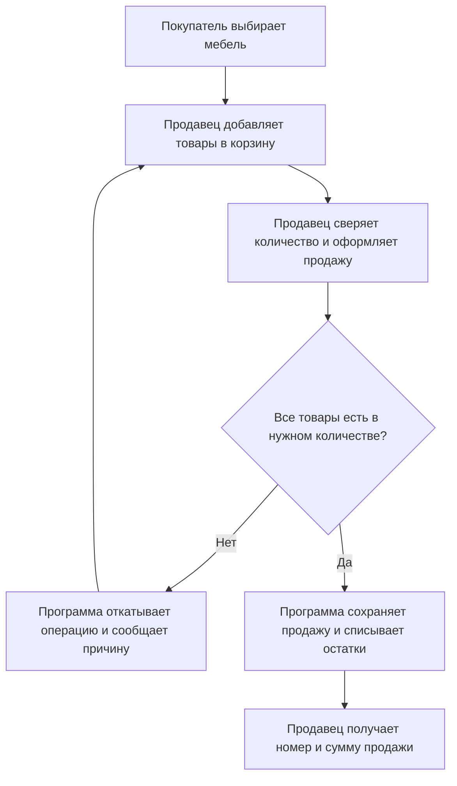
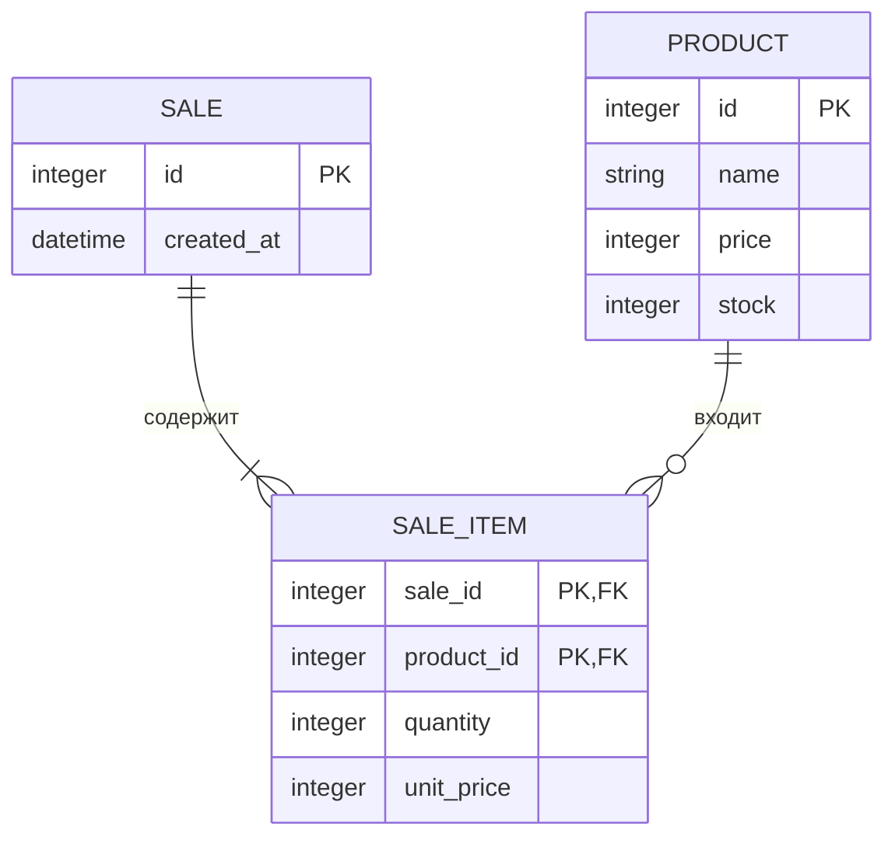

# Розничная торговля мебелью в торговом центре

«Форма» — учебная веб-витрина мебельного магазина на Vue 3. В каталоге 25 моделей: по пять диванов, столов, стульев, шкафов и кроватей. Продавец смотрит каталог и остатки, собирает покупку в корзине и оформляет продажу. Серверы на Python и Java обслуживают одну витрину и используют общую локальную базу SQLite.

## Запуск

Откройте PowerShell в папке `practice`. Установите зависимости и соберите витрину. Для сборки нужен Node.js 22.12 или новее из поддерживаемой ветки.

```powershell
npm.cmd ci
npm.cmd run build
```

Запустите один из серверов.

```powershell
python app.py
```

```powershell
java Main.java
```

После запуска откройте [127.0.0.1:8000](http://127.0.0.1:8000) в браузере. Сервер останавливается сочетанием **Ctrl+C** в терминале. Для одновременного запуска обеих версий задайте второй версии свободный порт, например командой `$env:FURNITURE_PORT = '8001'` в её терминале PowerShell.

Для Python нужна стандартная библиотека `sqlite3`. Для Java нужны JDK 21 и утилита `sqlite3` в `PATH`. Схема использует SQLite 3.37 или новее. При первом запуске сервер создаёт `furniture.db` и добавляет демонстрационные товары. При запуске с существующей базой он добавляет новые модели и сохраняет текущие цены, остатки и историю продаж.

При разработке оставьте сервер запущенным и выполните `npm.cmd run dev` во втором терминале. Vite выведет адрес для работы с Vue и перенаправит запросы к API на порт 8000. Если сервер запущен на другом порту, задайте ту же переменную `FURNITURE_PORT` перед запуском Vite.

Для демонстрации на новой базе добавьте в корзину два стула «Лофт» и один стол «Орион». Откройте **Корзину** и нажмите **Оформить продажу**. Сумма составит **19 500 ₽**, остатки уменьшатся до 8 стульев и 4 столов. В разделе **Продажи** появятся номер, дата, количество и сумма. Эти же данные доступны при запуске второго сервера.

| Файл | Назначение |
| --- | --- |
| [app.py](app.py) | Веб-сервер и процедурные функции на Python |
| [Main.java](Main.java) | Веб-сервер и объектно-ориентированная реализация на Java |
| [web](web/) | Компоненты Vue, стили и изображения общей витрины |
| [schema.sql](schema.sql) | Таблицы, ограничения, триггеры, представление и исходный каталог |
| [test_app.py](test_app.py) | Автоматические проверки обеих реализаций |

Изображения в `web/public/images/` созданы встроенным генератором. Для новых моделей использованы предметные фотографии на тёплом нейтральном фоне с мягким естественным светом.

## Предметная область и бизнес-процесс

В учебной модели рассматривается одна мебельная точка с общим запасом товаров. При ручном учёте продавец проверяет остатки по ведомости, рассчитывает сумму, записывает продажу и обновляет ведомость. Если обновить только одну запись, журнал продаж и остатки разойдутся. В приложении запись о продаже и списание товара выполняются одной транзакцией.

Входные данные процесса — выбранные товары и их количество. Результат — запись о продаже, её сумма и новые остатки. Остаток ведётся по каждой модели мебели в штуках. В корзине одна строка на каждую модель. При нехватке товара продавец может исправить состав покупки по согласованию с покупателем. Оплату и выдачу мебели сотрудники проводят по порядку магазина.



## Логическая модель данных

| Сущность | Атрибуты | Ключи |
| --- | --- | --- |
| Товар | Код, название, текущая цена, остаток | Код товара |
| Продажа | Номер, дата и время оформления | Номер продажи |
| Позиция продажи | Номер продажи, код товара, количество, цена на момент продажи | Номер продажи и код товара |

У продажи одна или несколько позиций. Каждый товар может встречаться в позициях разных продаж. Позиция связывает товар с продажей и сохраняет цену, действовавшую при оформлении. Поэтому история показывает исходную сумму даже после изменения цены в каталоге.



## Физическая модель данных

Схема SQLite создаёт таблицы `products`, `sales` и `sale_items`. Таблица `sale_items` имеет составной первичный ключ `(sale_id, product_id)` и внешние ключи к продаже и товару. Количество, остатки и цены в целых рублях хранятся как `INTEGER`. Дата и время сохраняются в UTC как `TEXT` в формате `ГГГГ-ММ-ДД ЧЧ:ММ:СС`.

Ограничения `CHECK` требуют положительных цен и количества в позиции, а также неотрицательного остатка. Триггер `check_sale_stock` проверяет наличие товара и достаточность остатка. Триггер `reduce_stock` уменьшает остаток после добавления позиции. Представление `sale_totals` считает для каждой продажи общее количество и сумму произведений количества на цену.

## Алгоритмы и структуры данных

1. **Просмотр каталога.** Сервер отдаёт товары по возрастанию кода. Страница показывает фотографии, названия, цены и остатки. Продавец может выбрать категорию.
2. **Формирование покупки.** Страница группирует товары по коду и показывает предварительную сумму. При оформлении она отправляет на сервер пары `код:количество`. Сервер проверяет положительные количества и объединяет повторяющиеся коды.
3. **Оформление продажи.** Начать транзакцию `BEGIN IMMEDIATE`, создать запись о продаже и сохранить позиции с текущими ценами. При записи каждой позиции SQLite проверяет и списывает остаток. Если все изменения выполнены, вычислить сумму, завершить транзакцию и вывести подтверждение. При ошибке откатить всю продажу вместе с изменениями остатков.
4. **Просмотр истории.** Прочитать из `sale_totals` номера, даты, количества и суммы, отсортированные от последней продажи к первой.

В Python бизнес-операции реализованы функциями. Словарь `dict` хранит количество по коду товара, а списки содержат результаты запросов и параметры вставки. В Java класс `Main` обрабатывает HTTP-запросы, `FurnitureStore` управляет каталогом и продажами, а `SqliteDatabase` запускает SQLite. Записи `Product`, `Sale` и `Receipt` представляют результаты операций. `LinkedHashMap` объединяет позиции по коду, а `List` хранит результаты запросов.

Обе реализации предоставляют одинаковые маршруты. `GET /api/products` возвращает каталог, `GET /api/sales` возвращает историю, `POST /api/sales` сохраняет покупку. Компоненты Vue обращаются к ним через `fetch`. Файл `web/catalog.js` связывает коды товаров с категориями и фотографиями.

## Тестирование и отладка

```powershell
npm.cmd run build
python -B -m unittest -v
```

Тесты компилируют Java, запускают серверы на свободных портах и проверяют HTTP-запросы. Для каждого теста они задают отдельный путь к временной базе `продажи.db` через переменную `FURNITURE_DB`.

| Сценарий | Проверенный результат |
| --- | --- |
| Открытие витрины | Сервер отдаёт страницу, стили, сценарий и фотографии |
| Первый запуск | Каталог содержит 25 товаров, история пуста |
| Недоступный путь к базе | Программа сообщает об ошибке и завершает работу |
| Несколько позиций с повтором кода | Количества объединяются, сумма и остатки рассчитаны верно |
| Нехватка второй позиции | Продажа и позиции не сохранены, запас первой позиции восстановлен |
| Неизвестный код и повторный ввод | Ошибочная продажа отменена, следующая проходит |
| Пустой запрос, неверный формат, нулевое количество и переполнение | Продажи не создаются |
| Открытие общей истории и изменение цены | Обе версии видят продажи, старые суммы сохраняются |
| Одновременная продажа последнего остатка | Успевает одна операция, остаток равен нулю |

Все девять тестов прошли на Python 3.14 и JDK 21.

На Windows тесты берут путь к JDK из `PATH`, чтобы выбрать установленную Java 21. Для открытия файлов с кириллицей Java передаёт путь утилите `sqlite3` во входном потоке UTF-8.

## Организационное обеспечение

| Роль | Обязанности |
| --- | --- |
| Продавец | Сверяет выбранные модели и количество с покупателем, оформляет продажу, проверяет подтверждение с номером и суммой |
| Управляющий | Сверяет историю продаж с кассовыми данными, проверяет остатки по результатам инвентаризации и согласует корректировки |
| Администратор | Поддерживает рабочее окружение, вносит согласованные изменения каталога и остатков через SQLite, отвечает за резервные копии |

При ошибке ввода продавец сверяет коды и количества и повторяет операцию. После сбоя продавец сначала открывает историю и проверяет, успела ли сохраниться продажа. Администратор закрывает обе программы перед копированием файла `furniture.db` и хранит резервную копию отдельно от рабочего файла. После восстановления администратор открывает каталог и историю, а управляющий сверяет последние продажи и остатки.
